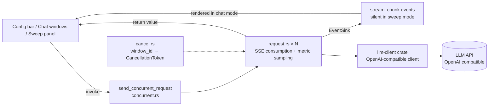

# ⚡ LLM Concurrency Testing Tool (llmperf)

> **Switch Language:** [中文](README.md) | **English**

A cross-platform desktop app built with [Tauri 2](https://tauri.app/) for **concurrent streaming load testing** of LLM APIs (OpenAI-compatible). It can render N parallel streams side by side, or ramp through a concurrency ladder automatically and plot throughput / latency curves with fine-grained jitter metrics.


## ✨ Features

- **Concurrent streaming requests**: up to 50 parallel streams, with the window count following the concurrency setting
- **Real-time streaming display**: tokens are pushed via `stream_chunk` events and rendered immediately
- **Fine-grained latency metrics**: TTFT, first-content latency, total duration, Prompt / Completion tok/s, TPOT, ITL P50/P95/max
- **Concurrency sweep**: ramp through steps like `1,2,4,8,16`, plot throughput / TTFT / TPOT curves and locate the saturation point
- **Per-run summary**: mean, P50, P95, min/max across windows plus overall throughput
- **CSV export**: per-window details and sweep summaries (BOM included, opens cleanly in Excel)
- **Controllable cancellation**: cancel a single window or everything, keeping the partial output
- **Internationalization**: Simplified Chinese / Traditional Chinese / English / Japanese / Korean, switchable from the menu
- **Native menu and shortcuts**: File / Run / View / Language / Window / Help groups, with items enabled or disabled according to the request and result state, and shortcuts for every common action
- **Cross-platform**: Linux, macOS and Windows, with a built-in dark theme

## 🖼 Modes

The top bar manages Base URL, API Key, Model and the test message, while the top-right switch selects the working mode. Max Tokens, Temperature, Top P, Frequency / Presence Penalty and Seed live in a collapsed **Advanced Parameters** panel (collapsed by default); leaving them empty uses the server defaults:

| Mode | Behavior | Use case |
|------|----------|----------|
| **Chat** | N parallel streams rendered per window, multi-turn context accumulated separately, with a run summary and per-window metrics when done | Inspect output quality, compare answers under different concurrency |
| **Sweep** | Steps through a concurrency ladder serially in silent mode (no per-token events), emitting only metrics, curves and a per-step table | Find the capacity ceiling and the throughput saturation point |

In chat mode, Enter sends, and each window can be canceled individually or all at once.

## ⌨️ Menu and Shortcuts

The app uses the native menu bar (a global menu bar on macOS, and the window-top bar on Linux / Windows):

| Menu | Contents |
|------|----------|
| File | Export this run (CSV), export sweep (CSV), open downloads folder, quit (non-macOS) |
| Run | Send, cancel all, clear, chat / sweep mode (radio), start sweep, stop sweep |
| View | Zoom in, zoom out, actual size, toggle fullscreen; (dev builds only) reload interface, developer tools |
| Language | Simplified Chinese / Traditional Chinese / English / Japanese / Korean |
| Window | Minimize, maximize, close |
| Help | Keyboard shortcuts, project homepage, usage docs, about (non-macOS) |

| Action | Shortcut |
|--------|----------|
| Send | `Ctrl / Cmd + Enter` |
| Cancel all | `Ctrl / Cmd + .` |
| Clear (chat summary or sweep results, depending on the mode) | `Ctrl / Cmd + Shift + K` |
| Chat mode / sweep mode | `Ctrl / Cmd + 1` / `Ctrl / Cmd + 2` |
| Start / stop sweep | `Ctrl / Cmd + Shift + S` / `Ctrl / Cmd + Shift + X` |
| Export run / sweep CSV | `Ctrl / Cmd + E` / `Ctrl / Cmd + Shift + E` |
| Keyboard shortcuts | `Ctrl / Cmd + /` |
| Zoom in / out / actual size | `Ctrl / Cmd + =` / `-` / `0` |
| Toggle fullscreen | `F11` |
| Reload interface / developer tools (dev builds only) | `Ctrl / Cmd + R` / `F12` |

Menu items follow the UI state:

- **Mode isolation**: Send is only available in chat mode, while Start / Stop sweep are only available in sweep mode — the two modes render mutually exclusive UIs, so triggering one from the other would “run something you cannot see”
- **Request state**: while a request is in flight, Send / Start sweep are grayed out and only Cancel all / Stop sweep remain clickable
- **Result state**: export items stay disabled until there is something to export, and switching modes or clearing results is blocked during a sweep

The **Help → Keyboard Shortcuts** dialog is generated from the backend menu definition, so its labels follow the current language.

## 📊 Metric Definitions

All timings are measured client-side; only the token speeds fall back to server-reported values. Canceled or failed requests are excluded from speed / jitter statistics so partial samples never pollute the summary.

| Metric | Meaning | Source |
|--------|---------|--------|
| **TTFT** | Time from sending the request to the first delta (reasoning or content) | Client-side timestamp |
| **First content** | Time to the first **content** delta; for reasoning models ≈ TTFT + thinking time | Client-side timestamp |
| **Duration** | Time from sending to end of stream | Client-side timestamp |
| **Prompt tok/s** | Prefill speed | API `timings` when available, otherwise `usage` + TTFT (cache hits deducted) |
| **Completion tok/s** | Decode speed | `timings.predicted_per_second` when available, otherwise `completion_tokens / (duration - TTFT)` |
| **TPOT** | Mean chunk interval = (last − first delta) / (deltas − 1) | Client-side timestamps |
| **ITL P50/P95/max** | Percentiles of consecutive delta intervals, exposing stalls | Client-side timestamps |
| **Throughput** | Total completion tokens of the run / wall-clock seconds | Aggregated |

> ⚠️ TPOT / ITL are measured in **SSE chunks**. When the server puts exactly one token per chunk, this equals the true per-token latency; if it packs several tokens per chunk, the numbers are inflated (a server implementation detail, not a measurement bug).

> 💡 Reasoning tokens are counted in Completion, so the decode window is anchored at the *first delta* rather than the first content delta — otherwise the thinking phase would be mistaken for prefill.

## 🛠 Tech Stack

| Layer | Technology |
|-------|------------|
| Frontend | [React 19](https://react.dev/) + [TypeScript](https://www.typescriptlang.org/) |
| Build tool | [Vite 7](https://vitejs.dev/) |
| Desktop framework | [Tauri 2](https://tauri.app/) (Rust) |
| HTTP client | [reqwest](https://crates.io/crates/reqwest) (OpenAI-compatible, connection pooling) |
| Async runtime | [tokio](https://tokio.rs/) (one task per request) |
| Streaming | [futures-util](https://crates.io/crates/futures-util) byte streams + a hand-written SSE parser |
| Serialization | [serde](https://serde.rs/) / [serde_json](https://crates.io/crates/serde_json) |
| Cancellation | [tokio-util](https://crates.io/crates/tokio-util) (`CancellationToken`) |
| System integration | [tauri-plugin-opener](https://crates.io/crates/tauri-plugin-opener) (opening project links and the downloads folder) |
| File saving | [tauri-plugin-dialog](https://crates.io/crates/tauri-plugin-dialog) (native save dialog when exporting) |
| Charts | Hand-written SVG (no chart library) |

## 📦 Installation

### Prerequisites

- [Rust](https://rustup.rs/) (recommended via rustup)
- [Node.js](https://nodejs.org/) ≥ 18
- npm ≥ 9

**Linux Additional Dependencies** (Ubuntu/Debian):

```bash
sudo apt install -y libwebkit2gtk-4.1-dev libappindicator3-dev librsvg2-dev patchelf
```

## 🚀 Quick Start

### Development Mode

```bash
# Install dependencies
npm install

# Start development server + Tauri window
npm run tauri dev
```

### Build Release Version

```bash
# Build frontend + Rust backend
npm run build

# Build Linux version
npm run tauri build -- --target x86_64-unknown-linux-gnu

# Build Windows version on non-Windows platforms
npm run tauri build -- --runner cargo-xwin --target x86_64-pc-windows-msvc
```

> 💡 Reference: [Windows Installer Build Guide](https://v2.tauri.app/distribute/windows-installer/)

#### Bundler Tool Download Mirror (Optional)

When packaging a Windows installer, Tauri downloads the NSIS toolchain and plugins from GitHub Releases (`nsis-*.zip`, `nsis_tauri_utils.dll`), and WiX for MSI. If GitHub is slow or unreachable, point the bundler to a mirror through these environment variables — no source changes needed:

| Variable | Description |
|----------|-------------|
| `TAURI_BUNDLER_TOOLS_GITHUB_MIRROR_TEMPLATE` | Template mode, supports `<owner>`, `<repo>`, `<version>`, `<asset>` placeholders; takes precedence |
| `TAURI_BUNDLER_TOOLS_GITHUB_MIRROR` | Domain-only mode, resolves to `<mirror>/https://github.com/...`, only usable if the mirror supports that path shape |

Template mode is recommended; replace `<your-mirror>` with any mirror that exposes a GitHub acceleration path:

```bash
# Placeholders are filled in by the bundler, no manual editing needed
# Example for Linux/macOS; on Windows use cross-env or system environment variables
export TAURI_BUNDLER_TOOLS_GITHUB_MIRROR_TEMPLATE='https://<your-mirror>/github.com/<owner>/<repo>/releases/download/<version>/<asset>'
```

The build log prints the actual request URL — seeing the mirror domain means it took effect. Notes:

- Only applies to `github.com/*/releases/download/*` URLs; other sources (such as the WebView2 installer) are unaffected
- SHA1 is still verified after download, so a mismatched mirror fails loudly instead of producing a broken installer
- Tools are cached in `~/.cache/tauri/NSIS` (Linux) and downloaded only once; delete that directory to force a re-download
- On non-Windows hosts the bundler calls the system `makensis` (Linux default `/usr/share/nsis`, override with `NSIS_PATH`), so NSIS must be installed

Build artifacts are located in `src-tauri/target/release/bundle/` directory, depending on the target platform:

| Platform | Format | Path |
|----------|--------|------|
| Linux | `.deb` / `.rpm` | `src-tauri/target/x86_64-unknown-linux-gnu/release/bundle/deb/` or `bundle/rpm/` |
| macOS | `.dmg` / `.app` | `src-tauri/target/release/bundle/dmg/` or `bundle/app/` |
| Windows | `.msi` / `.exe` | `src-tauri/target/release/bundle/msi/` or `bundle/nsis/` |

### Other Scripts

| Command | Description |
|---------|-------------|
| `npm run dev` | Start Vite frontend dev server only (no Tauri window) |
| `npm run build` | TypeScript type check + Vite frontend build |
| `npm run preview` | Preview built frontend artifacts |
| `npm run tauri dev` | Start Tauri development mode (frontend + desktop window) |
| `npm run tauri build` | Build release desktop application |

## 📖 Usage Guide

Both modes share the top configuration: Base URL, API Key, Model and the test message.
Expand **Advanced Parameters** to set Max Tokens, Temperature, Top P, Frequency Penalty, Presence Penalty and Seed. They are collapsed by default and fully optional — an empty field means "use the server default". **Fix Max Tokens when benchmarking**, otherwise tok/s is not comparable across runs.

### Chat Mode

1. Switch to **Chat** in the top-right corner
2. Fill in the Base URL (e.g. `http://127.0.0.1:16777/v1`), API Key and model name
3. Set the concurrency (1~50); the number of windows follows automatically
4. Type the test message and click 🚀 or press Enter
5. Each window streams independently; once finished, its header shows first token / first content / TPOT / ITL95 / tok/s
6. The summary panel below aggregates mean / P50 / P95 / min / max across windows, and can export CSV

Every window accumulates its own multi-turn history for display; the context sent to the model is based on window 0, so all windows always send the same prompt.

Windows get small at high concurrency: click a window title (or the ⛶ button) to expand it. Use `←` / `→` to switch windows, `1`~`9` to jump directly, and `Esc` to exit. An expanded view shows a thumbnail column on the left (window index + status dot + char count / duration·tok/s + latest output snippet); the active window is highlighted, and clicking another card switches to it. Use the ▤ button to hide the column on narrow windows. The message area follows the latest output automatically; scrolling up pauses it, and "Back to bottom" resumes.

### Concurrency Sweep

1. Switch to **Sweep** in the top-right corner
2. Enter the concurrency ladder, e.g. `1,2,4,8,16` (comma or space separated, de-duplicated and sorted, at most 8 steps)
3. Set rounds per step (1~5): more rounds smooth single-run noise but multiply the total sweep time
4. Type the message and click 📈 Start sweep
5. Read the curves and the table: **the step where throughput stops rising and TTFT / TPOT starts to bend upward is the saturation point**
6. Click Stop to abort at any time; the unfinished step is not recorded

The sweep runs in silent mode: no per-token events and no window rendering, so it is not limited by frontend rendering capacity.
Steps run serially — the next step starts only after the previous one has fully finished — so samples from different steps never overlap.

### Export

- **Chat mode**: exports the **per-window details** for the last run, with columns
  `window,status,ttft_ms,first_content_ms,duration_ms,tpot_ms,itl_p50_ms,itl_p95_ms,itl_max_ms,prompt_tokens,completion_tokens,completion_tps,prompt_tps,error`
- **Sweep mode**: exports **one row per step**, with columns
  `concurrency,rounds,success,failed,canceled,wall_clock_ms,throughput_tps,ttft_p50_ms,ttft_p95_ms,first_content_p50_ms,tpot_avg_ms,completion_tps_p50,duration_p95_ms,itl_p95_avg_ms`

Exporting opens a native save dialog: it defaults to the system downloads directory with a timestamped file name, and you can change both the directory and the file name; canceling writes nothing. Files carry a UTF-8 BOM so Excel reads them correctly.

## 🔧 Architecture Overview



- **Frontend** only collects configuration, renders events and aggregates statistics; all metric computation (TTFT / ITL / tok/s) happens in Rust so JS timing is never skewed by rendering.
- **Reusable client** lives in its own crate `llm-client` (no Tauri dependency) and owns HTTP/SSE parsing, retries, cancellation and metric helpers, so other projects can depend on it directly.
- **Backend** maps each `window_id` to a `tokio` task with its own cancellation token; a single `EventSink` decides whether events are pushed to the frontend.
- **Silent mode** (`config.silent = true`) drops all events and returns results only through the command return value — this is what makes a sweep with dozens of parallel requests viable.
- **Menu** is built and kept up to date by the backend: the frontend pushes UI state through `set_menu_state`, while menu actions that depend on UI state (send, export, mode switch) are turned into `menu-command` events for the frontend, and the rest (window, zoom, fullscreen, opening links) are handled in Rust directly.

## 📁 Project Structure

```
src/                      # Frontend (React + TypeScript)
├── App.tsx               # Main UI: config bar, mode switch, chat windows, summary, menu command dispatch, shortcut dialog
├── SweepPanel.tsx        # Sweep panel: SVG charts + per-step table
├── metrics.ts            # Metric aggregation, statistics, CSV export
└── i18n/                 # Internationalization (zh-SC / zh-TC / en / ja / ko)

src-tauri/src/            # Backend (Rust)
├── lib.rs                # Tauri commands, menu action dispatch, window/zoom/fullscreen, file export
├── request.rs            # Single streaming request: consume client events, aggregate metrics, emit events
├── concurrent.rs         # N-way concurrency orchestration
├── cancel.rs             # Cancellation registry keyed by window_id
├── types.rs              # Shared data structures (SingleResult / StreamChunkEvent, ...)
└── menu.rs               # Native menu: MENU_DEFS table, state linkage, in-place language update

src-tauri/crates/llm-client/   # Reusable OpenAI-compatible client (standalone crate)
├── README.md             # Usage guide: quick start / config / events / metrics / compatibility
├── src/client.rs         # Request building, retries/backoff, cancellation, streaming adapter
├── src/config.rs         # Client config (auth style / layered timeouts / proxy / custom headers)
├── src/message.rs        # Message model (multimodal / tool calls / reasoning chain)
├── src/params.rs         # Request params (sampling / tools / structured output / embeddings)
├── src/response.rs       # Response model (usage details / timings / model list / embeddings)
├── src/sse.rs            # SSE decoder (in-memory, no I/O, unit-testable)
├── src/stream.rs         # Stream events, ChatStream, result accumulator
├── src/metrics.rs        # TTFT / TPOT / ITL / token speed
├── tests/mock_server.rs  # Local mock HTTP integration tests (no network)
└── examples/             # Runnable chat / stream examples
```

## 🧩 Reusable LLM Client (llm-client)

OpenAI-compatible calls live in a standalone crate with no Tauri dependency, so other Rust projects can reuse them directly:

```rust
use llm_client::{ChatMessage, ChatParams, ClientConfig, LlmClient};

let client = LlmClient::new(ClientConfig::new("https://api.deepseek.com/v1", "sk-xxx"))?;
let params = ChatParams::new("deepseek-chat").with_temperature(0.2);
let reply = client.chat(vec![ChatMessage::user("hello")], &params).await?;
println!("{}", reply.content());
```

Covers: streaming and non-streaming calls, reasoning content, tool calling (including streaming delta
accumulation), multimodal input, multiple choices, cancellation tokens, retries with backoff, layered
timeouts (connect / response headers / stream idle), structured errors (status + business code +
Retry-After), model listing and embeddings, plus TTFT / TPOT / ITL / tok-s metric helpers.

The full API reference, config defaults, event semantics and vendor compatibility notes live in
[crates/llm-client/README.md](src-tauri/crates/llm-client/README.md).

## 🧪 Testing

```bash
# Frontend type check
npx tsc --noEmit

# Backend unit tests + mock integration tests (no network)
cd src-tauri && cargo test -p llm-client     # client: unit tests + local mock HTTP tests
cargo test -p llmperf --lib                 # app-level unit tests

# Live tests against a real API: export the env vars, then run
# (skipped automatically when the env vars are absent)
export LLMPERF_TEST_BASE_URL="http://127.0.0.1:16777/v1"
export LLMPERF_TEST_API_KEY="sk-xxx"
export LLMPERF_TEST_MODEL_CHAT="testllm-nk"
export LLMPERF_TEST_MODEL_REASONER="testllm"

cargo test -p llm-client --test live_api    # live client tests (incl. TPOT/ITL definition)
```

Without the environment variables the live tests skip instead of failing, keeping CI green.

Menu unit tests check that all five locales are fully translated, that menu IDs and shortcuts are unique, and that the enabled/disabled rules hold for each UI state.

## 🤖 Development Notes

This project was developed using **Vibe Coding** methodology, with full AI-assisted coding throughout.

## 📄 License

[Apache License 2.0](LICENSE)
