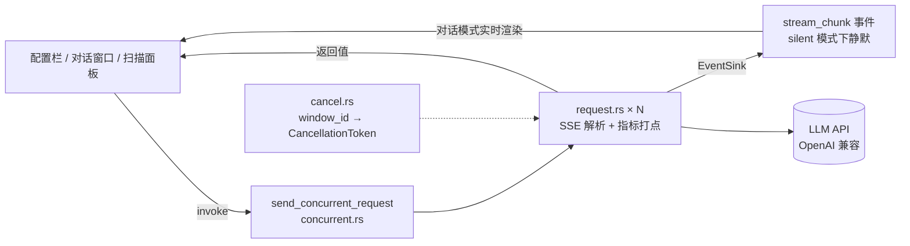

# ⚡ LLM 并发测试工具 (llmperf)

> **切换语言:** [English](README.en.md) | **中文**

一款基于 [Tauri 2](https://tauri.app/) 开发的跨平台桌面应用，用于对 LLM API（兼容 OpenAI 接口）做**并发流式压测**：既能逐窗口对比多路输出，也能按并发梯度自动加压，输出吞吐 / 延迟曲线与细粒度抖动指标。


## ✨ 功能特性

- **并发流式请求**：最多 50 路并发，窗口数量随并发数动态增减，实时对比各窗口输出
- **实时流式展示**：通过 `stream_chunk` 事件推送 Token，前端即时渲染
- **细粒度延迟指标**：TTFT、正文首字、总耗时、Prompt / Completion tok/s、TPOT、ITL P50/P95/max
- **并发梯度扫描**：按 `1,2,4,8,16` 等梯度逐档加压，绘制吞吐 / TTFT / TPOT 曲线，直观定位服务饱和点
- **本轮汇总统计**：跨窗口的均值、P50、P95、最小/最大值与整体吞吐
- **结果导出**：逐窗口明细与扫描汇总均可导出 CSV（带 BOM，Excel 直接打开）
- **可控取消**：支持单窗口取消与一键全部取消，已输出内容不丢失
- **国际化**：内置简体中文 / 繁體中文 / English / 日本語 / 한국어，菜单栏一键切换
- **原生菜单与快捷键**：文件 / 运行 / 视图 / 语言 / 窗口 / 帮助 分组，菜单项随请求与结果状态自动启用禁用，常用动作全部带快捷键
- **跨平台**：基于 Tauri，支持 Linux、macOS、Windows；内置暗色主题

## 🖼 界面与模式

顶部配置栏统一管理 Base URL、API Key、Model 与测试消息，右上角切换两种工作模式；Max Tokens、Temperature、Top P、Frequency / Presence Penalty、Seed 收在「模型高级参数」折叠面板中，默认不展开，且全部留空即使用服务端默认值：

| 模式 | 行为 | 适合场景 |
|------|------|----------|
| **对话模式** | N 路并发逐窗口渲染流式输出，多轮上下文各自累积，结束后显示本轮汇总与逐窗口指标 | 观察输出质量、对比不同并发下的回答差异 |
| **梯度扫描** | 按并发梯度逐档串行加压，静默执行（不推送逐 token 事件），只输出指标、曲线与逐档对比表 | 测服务容量上限、找吞吐饱和点 |

对话模式下支持 Enter 快速发送、单窗口取消、一键全部取消与清空。

## ⌨️ 菜单与快捷键

应用使用系统原生菜单栏（macOS 为全局菜单栏，Linux / Windows 位于窗口顶部）：

| 菜单 | 内容 |
|------|------|
| 文件 | 导出本轮 CSV、导出扫描 CSV、打开下载目录、（非 macOS）退出 |
| 运行 | 发送、全部取消、清空、对话模式 / 梯度扫描（单选）、开始扫描、停止扫描 |
| 视图 | 放大、缩小、实际大小、切换全屏；（开发模式额外有重新加载界面、开发者工具） |
| 语言 | 简体中文 / 繁體中文 / English / 日本語 / 한국어 |
| 窗口 | 最小化、最大化、关闭 |
| 帮助 | 快捷键一览、项目主页、使用文档、（非 macOS）关于 |

| 操作 | 快捷键 |
|------|--------|
| 发送 | `Ctrl / Cmd + Enter` |
| 全部取消 | `Ctrl / Cmd + .` |
| 清空（按当前模式清对话汇总或扫描结果） | `Ctrl / Cmd + Shift + K` |
| 对话模式 / 梯度扫描 | `Ctrl / Cmd + 1` / `Ctrl / Cmd + 2` |
| 开始扫描 / 停止扫描 | `Ctrl / Cmd + Shift + S` / `Ctrl / Cmd + Shift + X` |
| 导出本轮 / 导出扫描 CSV | `Ctrl / Cmd + E` / `Ctrl / Cmd + Shift + E` |
| 快捷键一览 | `Ctrl / Cmd + /` |
| 放大 / 缩小 / 实际大小 | `Ctrl / Cmd + =` / `-` / `0` |
| 切换全屏 | `F11` |
| 重新加载界面 / 开发者工具（仅开发模式） | `Ctrl / Cmd + R` / `F12` |

菜单项会跟随界面状态变化：

- **按模式隔离**：「发送」只在对话模式可用，「开始扫描 / 停止扫描」只在梯度扫描模式可用——两种模式的界面元素互斥渲染，跨模式触发会出现“跑了却看不到结果”
- **按请求状态**：请求在途时「发送 / 开始扫描」置灰，只剩「全部取消 / 停止扫描」可点
- **按结果状态**：没有可导出的结果时对应导出项置灰；扫描进行中不能切换模式，也不能清空结果

「帮助 → 快捷键一览」的弹窗内容直接来自后端菜单定义，切换语言后文案同步更新。

## 📊 指标口径

所有时间均由客户端打点，不依赖服务端自报（除 `timings` 外）；取消或中途出错的请求不参与速度 / 抖动统计，避免半截样本污染汇总。

| 指标 | 含义 | 数据来源 |
|------|------|----------|
| **TTFT** | 从发起请求到首个增量（思考或正文）到达 | 客户端打点 |
| **正文首字** | 到首个**正文**增量到达；推理模型下 ≈ TTFT + 思考耗时 | 客户端打点 |
| **总耗时** | 发起请求到流结束 | 客户端打点 |
| **Prompt tok/s** | prefill 阶段速度 | 优先 API `timings`，退化时用 `usage` + TTFT 反推（并扣除 cache 命中 token） |
| **Completion tok/s** | 解码阶段速度 | 优先 API `timings.predicted_per_second`，退化时用 `completion_tokens / (总耗时 - TTFT)` |
| **TPOT** | 平均分片间隔 = (末增量 − 首增量) / (增量数 − 1) | 客户端打点 |
| **ITL P50/P95/max** | 相邻增量间隔的分位数，用于发现偶发卡顿 | 客户端打点 |
| **吞吐** | 本轮总 completion token / 墙钟秒数 | 汇总计算 |

> ⚠️ TPOT / ITL 以 **SSE 分片**为单位统计：服务端一个分片只含一个 token 时即为严格的逐 token 延迟；若一个分片打包多个 token，数值会偏大（这是服务端实现差异，不是统计错误）。

> 💡 推理模型的思考 token 计入 Completion，因此统计补全阶段时锚点取「首个增量」而非「首个正文」，否则会把思考时间误算进 prefill。

## 🛠 技术栈

| 层级 | 技术 |
|------|------|
| 前端框架 | [React 19](https://react.dev/) + [TypeScript](https://www.typescriptlang.org/) |
| 构建工具 | [Vite 7](https://vitejs.dev/) |
| 桌面框架 | [Tauri 2](https://tauri.app/) (Rust) |
| HTTP 客户端 | [reqwest](https://crates.io/crates/reqwest)（对接 OpenAI 兼容接口，连接池复用） |
| 异步运行时 | [tokio](https://tokio.rs/)（每路请求一个任务） |
| 流式解析 | [futures-util](https://crates.io/crates/futures-util)（字节流）+ 自实现 SSE 解析器 |
| 序列化 | [serde](https://serde.rs/) / [serde_json](https://crates.io/crates/serde_json) |
| 取消控制 | [tokio-util](https://crates.io/crates/tokio-util)（`CancellationToken`） |
| 系统集成 | [tauri-plugin-opener](https://crates.io/crates/tauri-plugin-opener)（打开项目链接与下载目录） |
| 图表 | 手写 SVG（不引入图表库） |

## 📦 安装

### 前置依赖

- [Rust](https://rustup.rs/)（推荐通过 rustup 安装）
- [Node.js](https://nodejs.org/) ≥ 18
- npm ≥ 9

**Linux 额外依赖**（Ubuntu/Debian）：

```bash
sudo apt install -y libwebkit2gtk-4.1-dev libappindicator3-dev librsvg2-dev patchelf
```

## 🚀 快速开始

### 开发模式

```bash
# 安装依赖
npm install

# 启动开发服务器 + Tauri 窗口
npm run tauri dev
```

### 构建发布版本

```bash
# 构建前端 + Rust 后端
npm run build

# 构建linux版本
npm run tauri build -- --target x86_64-unknown-linux-gnu

# 在非 Windows 平台构建 Windows 版本
npm run tauri build -- --runner cargo-xwin --target x86_64-pc-windows-msvc
```

> 💡 参考链接：[Windows Installer 构建指南](https://v2.tauri.app/distribute/windows-installer/)

构建产物位于 `src-tauri/target/release/bundle/` 目录下，具体取决于目标平台：

| 平台 | 格式 | 路径 |
|------|------|------|
| Linux | `.deb` / `.rpm` | `src-tauri/target/x86_64-unknown-linux-gnu/release/bundle/deb/` 或 `bundle/rpm/` |
| macOS | `.dmg` / `.app` | `src-tauri/target/release/bundle/dmg/` 或 `bundle/app/` |
| Windows | `.msi` / `.exe` | `src-tauri/target/release/bundle/msi/` 或 `bundle/nsis/` |

### 其他脚本

| 命令 | 说明 |
|------|------|
| `npm run dev` | 仅启动 Vite 前端开发服务器（无 Tauri 窗口） |
| `npm run build` | TypeScript 类型检查 + Vite 构建前端 |
| `npm run preview` | 预览构建后的前端产物 |
| `npm run tauri dev` | 启动 Tauri 开发模式（前端 + 桌面窗口） |
| `npm run tauri build` | 构建发布版桌面应用 |

## 📖 使用说明

两种模式共用顶部配置：Base URL、API Key、Model 与测试消息。
点击「模型高级参数」可展开 Max Tokens、Temperature、Top P、Frequency Penalty、Presence Penalty、Seed；这些参数默认收起且都是可选的，留空表示交给服务端默认值。**压测时建议固定 Max Tokens**，否则不同轮次的 tok/s 无法横向比较。

### 对话模式

1. 右上角切到「对话模式」
2. 填入 Base URL（如 `http://127.0.0.1:16777/v1`）、API Key、模型名
3. 设置并发数（1~50），窗口数量自动跟随
4. 输入测试消息，点击 🚀 发送或按 Enter
5. 每个窗口独立接收流式响应，完成后窗口头部显示 首字 / 正文 / TPOT / ITL95 / tok/s
6. 底部汇总面板给出跨窗口的 均值 / P50 / P95 / 最小 / 最大，可导出 CSV

每个窗口都会累积自己的多轮消息用于展示；发给模型的上下文以 0 号窗口的历史为 基准，因此各窗口的输入 prompt 始终一致。

高并发时网格里的窗口很小，点击窗口标题（或右上角 ⛶）可放大查看该窗口：`←` / `→` 切换窗口、数字键 1~9 直达、`Esc` 退出。放大后左侧是一列缩略卡片（窗口序号 + 状态点 + 字符数/耗时·tok/s + 最新输出片段），当前窗口高亮，点其他卡片即切换；窄窗口可用右上角 ▤ 关闭，把宽度还给对话区。消息区会自动跟随最新输出；手动上滚查看历史后暂停跟随，点击「回到底部」恢复。

### 梯度扫描

1. 右上角切到「梯度扫描」
2. 填写并发梯度，如 `1,2,4,8,16`（逗号或空格分隔，自动去重升序，最多 8 档）
3. 设置每档轮次（1~5）：多轮可平滑单次噪声，但会成倍拉长扫描时间
4. 输入消息，点击 📈 开始扫描
5. 观察曲线与表格：**吞吐不再上升、TTFT / TPOT 开始翘头的那一档就是饱和点**
6. 点击「停止」可随时中断，未跑完的档位不会计入结果

扫描为静默模式：不推送逐 token 事件、不渲染窗口内容，只采集指标，因此不受前端渲染能力的限制。
每档串行执行，上一档全部结束才开始下一档，避免不同档位的样本互相干扰。

### 导出

- **对话模式**：导出本轮**逐窗口明细**，字段为
  `window,status,ttft_ms,first_content_ms,duration_ms,tpot_ms,itl_p50_ms,itl_p95_ms,itl_max_ms,prompt_tokens,completion_tokens,completion_tps,prompt_tps,error`
- **梯度扫描**：导出**每档一行**的汇总，字段为
  `concurrency,rounds,success,failed,canceled,wall_clock_ms,throughput_tps,ttft_p50_ms,ttft_p95_ms,first_content_p50_ms,tpot_avg_ms,completion_tps_p50,duration_p95_ms,itl_p95_avg_ms`

文件写入系统下载目录，带 UTF-8 BOM，Excel 直接打开不乱码。

## 🔧 架构说明



- **前端** 只负责采集配置、展示事件与聚合统计；指标计算（TTFT / ITL / tok/s）全部在后端完成，避免 JS 计时受渲染阻塞影响。
- **后端** 每个 `window_id` 对应一个 `tokio` 任务，独立注册取消令牌；`EventSink` 统一控制是否向前端推送事件。
- **静默模式**（`config.silent = true`）下事件被丢弃，结果只通过命令返回值回传，这是梯度扫描能跑几十路并发的前提。
- **菜单** 由后端建立并维护可用性 / 勾选状态：前端通过 `set_menu_state` 推送界面状态，菜单动作中依赖界面状态的部分（发送、导出、切模式）由后端转成 `menu-command` 事件交前端执行，其余（窗口、缩放、全屏、打开链接）在后端直接完成。

## 📁 项目结构

```
src/                      # 前端（React + TypeScript）
├── App.tsx               # 主界面：配置栏、模式切换、对话窗口、汇总表、菜单命令分发、快捷键弹窗
├── SweepPanel.tsx        # 梯度扫描面板：SVG 曲线 + 逐档表格
├── metrics.ts            # 指标聚合、统计量计算、CSV 导出
└── i18n/                 # 国际化（zh-SC / zh-TC / en / ja / ko）

src-tauri/src/            # 后端（Rust）
├── lib.rs                # Tauri 命令注册、菜单动作分发、窗口/缩放/全屏、导出文件
├── request.rs            # 单次流式请求：SSE 消费、指标计算、事件发射
├── concurrent.rs         # N 路并发编排
├── cancel.rs             # 按 window_id 的取消注册表
├── types.rs              # 前后端数据结构（SingleResult / StreamChunkEvent 等）
├── llm_tool.rs           # OpenAI 兼容客户端与 SSE 解析器
└── menu.rs               # 原生菜单：MENU_DEFS 表驱动 + 状态联动 + 语言就地更新
```

## 🧪 测试

```bash
# 前端类型检查
npx tsc --noEmit

# 后端单元测试（无需网络）
cd src-tauri && cargo test --lib

# 需要真实 API 的联调测试：配置环境变量后手动运行
# （包含流式调用、推理模型与 TPOT/ITL 口径校验，默认 #[ignore]）
export LLMPERF_TEST_BASE_URL="http://127.0.0.1:16777/v1"
export LLMPERF_TEST_API_KEY="sk-xxx"
export LLMPERF_TEST_MODEL_CHAT="testllm-nk"
export LLMPERF_TEST_MODEL_REASONER="testllm"

cargo test --test llm_tool_integration   # 客户端集成测试
cargo test --lib -- --ignored            # 指标口径联调测试
```

未设置对应环境变量时，联调测试会自动跳过而不是失败，方便在 CI 中保持绿灯。

菜单相关单测会校验五份语言包是否漏翻、菜单 ID 与快捷键是否唯一，以及各状态下菜单项的可用性规则。

## 🤖 开发说明

本项目使用 **Vibe Coding** 方式开发完成，全程由 AI 辅助编码。

## 📄 许可证

[Apache License 2.0](LICENSE)
